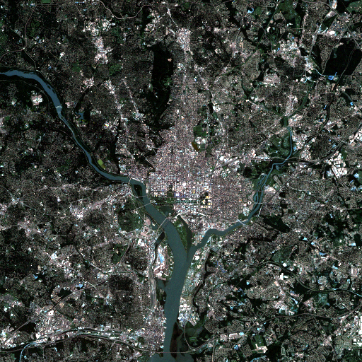
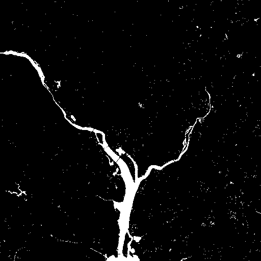
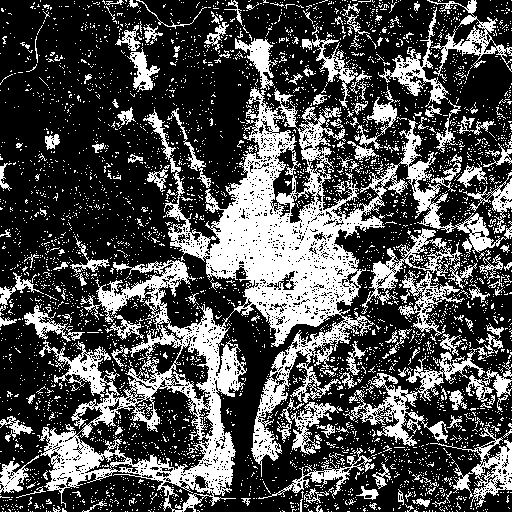
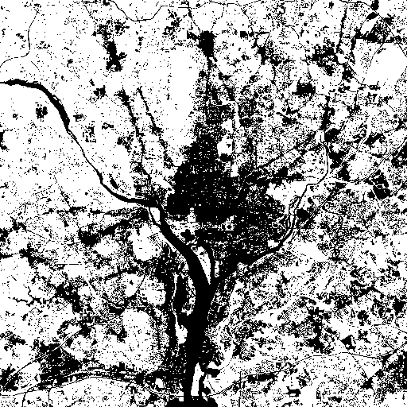
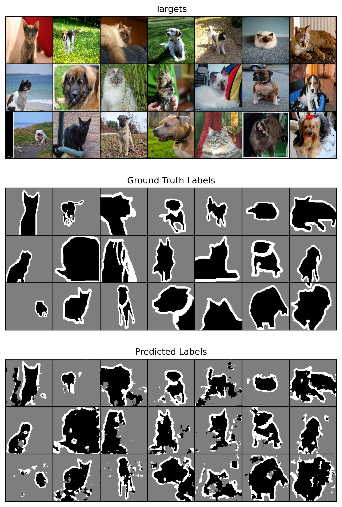
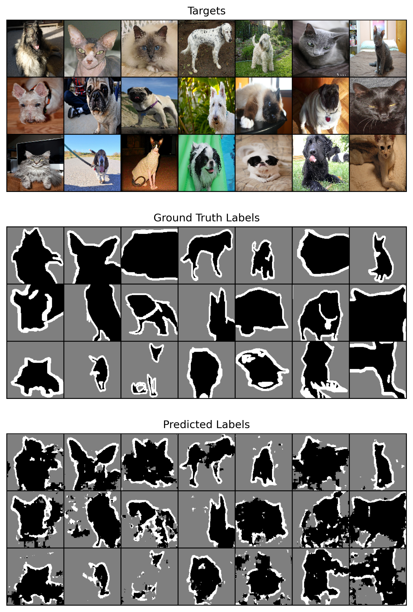
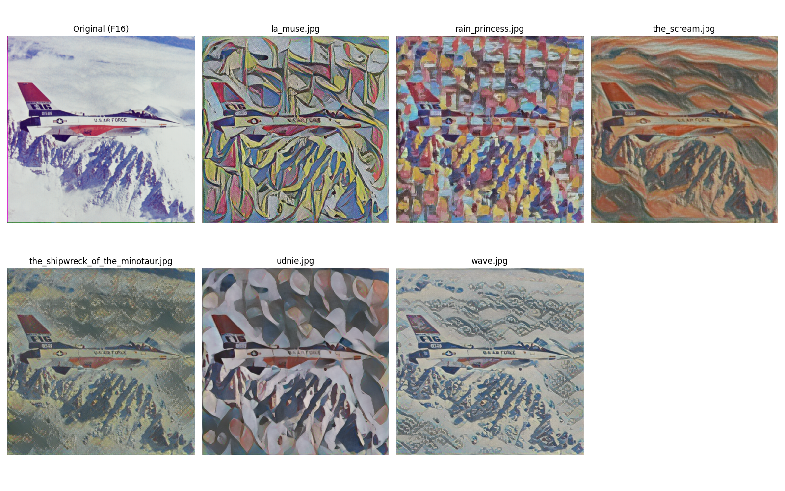
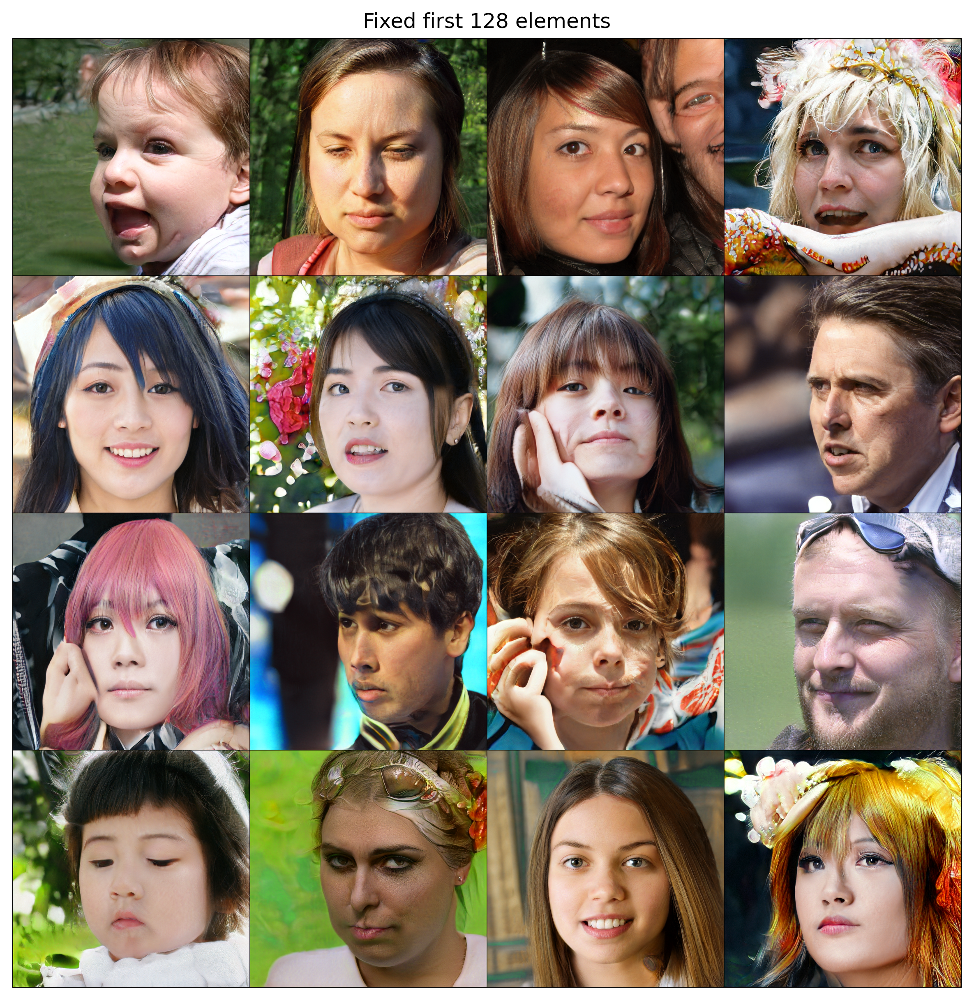
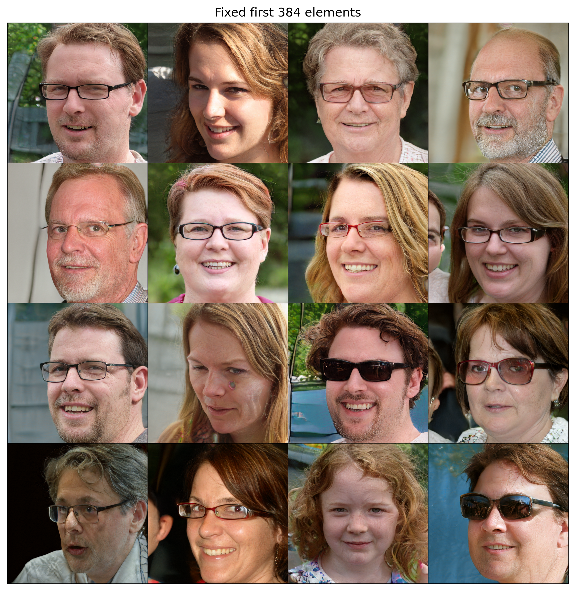
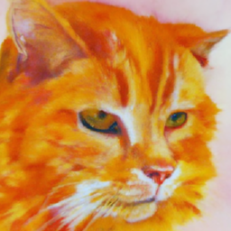

# Image Processing & Generative AI Homework

影像處理與生成式人工智慧兩門課的作業程式碼。

- **影像處理**（`IP_HW*`）：以 MATLAB 為主，練習傳統數位影像處理方法，例如濾波、邊緣偵測、特徵擷取。
- **生成式人工智慧**（`AI_HW*`）：以 PyTorch / TensorFlow 實作神經網路，主題從影像分類、Semantic Segmentation，一路到 Style Transfer、GAN 與 Diffusion Model。

## 目錄結構

```
image-processing/
├─ AI_HW1/      神經網路基礎與多光譜衛星影像分類
├─ AI_HW2/      Oxford-IIIT Pet 影像分割（U-Net、SegNet）
├─ AI_HW3/      Arbitrary Style Transfer
├─ AI_HW4/      StyleGAN latent vector 實驗
├─ AI_HW5/      GLIDE 文字生成圖片
├─ IP_HW1~5.m   影像處理作業（MATLAB）
├─ IP_HW6.py    影像處理作業（PyTorch）
└─ F16.tiff     影像處理作業共用的測試圖
```

## 環境需求

**Python**

```bash
pip install torch torchvision tensorflow tensorflow-hub opencv-python numpy matplotlib pillow ipython
pip install git+https://github.com/openai/glide-text2im   # AI_HW5 用
```

**MATLAB**：需要 Image Processing Toolbox 與 Computer Vision Toolbox（`IP_HW5` 的 Harris、MSER 會用到）。

## 執行方式

程式都是用相對路徑讀寫檔案，**請在各作業資料夾內執行**：

- 用 VS Code 開啟整個 repo，直接按 F5 或右上角 ▶ 執行即可。`.vscode/` 已設定成會自動切換到程式所在的資料夾。
- 在終端機執行時，請先 `cd` 進作業資料夾，例如：

  ```bash
  cd AI_HW2
  python unet.py
  ```

- MATLAB 請將目前資料夾設為 repo 根目錄，再執行 `IP_HW*.m`。

### 需要另外下載或產生的檔案

以下檔案太大、可自動下載或可自行訓練，所以沒有放進 repo：

| 檔案 | 怎麼取得 |
|---|---|
| `AI_HW2/datasets/` | 第一次執行 `AI_HW2` 任一程式時會自動下載 Oxford-IIIT Pet（train、test 各一份，共約 1.6 GB） |
| `AI_HW2/*.pth` | 先執行訓練程式（例如 `unet.py`）產生，再執行對應的 `*_test.py` |
| `AI_HW5/glide_model_cache/` | 第一次執行 `ai_hw5.py` 時自動下載 GLIDE 模型（約 3 GB） |
| AI_HW3、AI_HW4 的模型 | 執行時自動從 TF Hub / PyTorch Hub 下載 |

## 生成式人工智慧（AI_HW）

### AI_HW1：神經網路基礎與衛星影像分類

| 程式 | 內容 |
|---|---|
| `ai_hw1_1.py` | 4 層全連接神經網路，以 Cross Entropy Loss 解 XOR 分類問題，並畫出機率曲面與 loss 曲線 |
| `ai_hw1_2.py` | 用 R、G、B、近紅外線 4 個波段的像素值，將衛星影像分成水域、都市、植被三類 |
| `example*.py` | 課程提供的範例；`example2data.py` 會由 `example2/` 的影像產生訓練資料 `example2data.npy` |

<table>
  <tr>
    <th>原始影像</th><th>水域</th><th>都市</th><th>植被</th>
  </tr>
  <tr>
    <td></td>
    <td></td>
    <td></td>
    <td></td>
  </tr>
</table>

### AI_HW2：Oxford-IIIT Pet 影像分割

以 Oxford-IIIT Pet 的 trimap（前景、背景、邊界三類）訓練 Semantic Segmentation 模型，比較不同網路結構：

| 程式 | 模型 |
|---|---|
| `unet.py` | 3 層 U-Net |
| `unet5.py` | 4 層 U-Net（較深） |
| `ai_hw2_1.py` | 2 層 U-Net，第二個卷積改為 Grouped Convolution |
| `ai_hw2_2.py` | 2 層 U-Net |
| `segnet.py` | SegNet（以 MaxUnpool 還原解析度） |

每個訓練程式都有對應的 `*_test.py`，會在測試集上顯示原圖、Ground Truth 與預測結果。

<table>
  <tr>
    <th>2 層 U-Net + Grouped Convolution</th><th>2 層 U-Net</th>
  </tr>
  <tr>
    <td></td>
    <td></td>
  </tr>
</table>

### AI_HW3：Arbitrary Style Transfer

使用 TF Hub 上 Magenta 的 Arbitrary Image Stylization 模型，將 F16 戰鬥機照片轉換成 6 種名畫風格。



### AI_HW4：StyleGAN Latent Vector 實驗

用預訓練的 StyleGAN 生成 16 張人臉。這 16 組 512 維 latent vector 的前 128 個或前 384 個元素設為相同，觀察固定越多元素時，生成的人臉會有多相似。

<table>
  <tr>
    <th>固定前 128 個元素</th><th>固定前 384 個元素</th>
  </tr>
  <tr>
    <td></td>
    <td></td>
  </tr>
</table>

### AI_HW5：GLIDE 文字生成圖片

使用 OpenAI 的 GLIDE Diffusion Model：先由 base model 生成 64×64 的圖，再用 upsampler 放大到 256×256。

Prompt：`A oil painting of a fluffy orange cat`



## 影像處理（IP_HW）

都以 `F16.tiff` 作為測試影像。

| 作業 | 內容 |
|---|---|
| `IP_HW1.m` | 灰階直方圖；影像縮放與旋轉（Nearest vs. Bicubic Interpolation） |
| `IP_HW2.m` | Histogram Matching；Laplacian Filter；去雜訊（Wiener、Bilateral、Non-Local Means、Median Filter） |
| `IP_HW3.m` | DCT 保留低頻後重建影像；依灰階範圍上色（Pseudo-color） |
| `IP_HW4.m` | Canny 邊緣偵測；Hough Transform 直線偵測；Otsu 二值化；K-means 分割 |
| `IP_HW5.m` | Active Contour；Harris Corner；MSER 特徵區域 |
| `IP_HW6.py` | 簡單神經網路做二維分類，畫出 Decision Boundary 與 3D 機率曲面 |
